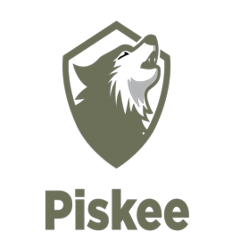
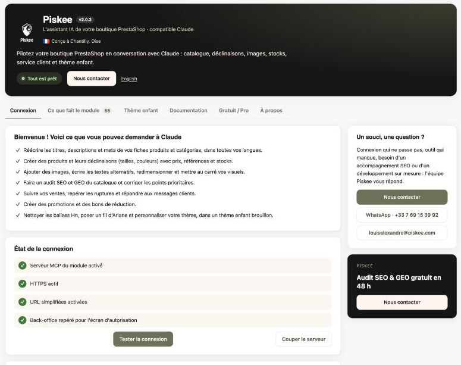

<p align="center">
  
</p>

<h1 align="center">Run your PrestaShop store by talking to Claude</h1>

<p align="center">
  <strong>Piskee</strong> is the AI sidekick for PrestaShop.<br>
  Ask in plain words, review, approve: Claude does the back office work for you.
</p>

<p align="center">
  <a href="https://github.com/Piskeeagence/Prestashop-Claude-Connector/releases/latest"></a>
  
  
  
  
</p>

<p align="center">
  <a href="https://github.com/Piskeeagence/Prestashop-Claude-Connector/releases/latest"><strong>⬇ Download the module</strong></a> ·
  <a href="#set-up-in-5-minutes">Set up in 5 minutes</a> ·
  <a href="#-en-français">Français</a> ·
  <a href="#-en-español">Español</a> ·
  <a href="#-in-italiano">Italiano</a> ·
  <a href="#-po-polsku">Polski</a>
</p>

---

## Your back office, minus the busywork

Running a PrestaShop store means hours of small, repetitive tasks: rewriting product texts, building size and colour variants, chasing tracking numbers, answering "where is my order?". You know what needs doing, but the clicks take the time.

With Piskee, you describe the result and Claude does the clicks, **in your own back office, with your rights, after your approval.**

> *"Rewrite the meta descriptions of the Dresses category, under 155 characters, in French and English."*
> *"Create sizes S to XL in black and white for this T-shirt, 10 units each."*
> *"Which paid orders still have no tracking number?"*
> *"Find the products customers buy together, and suggest related products for my 15 best sellers."*
> *"Our product pages have two H1 headings. Fix it in a draft theme so I can check before it goes live."*

<p align="center">
  
</p>

## The usual way vs. with Piskee

| Task | The usual way | With Piskee |
|---|---|---|
| SEO texts for a whole category | Open each product, write, save, repeat | One sentence. You review the batch and approve it |
| 12 combinations with stock and references | Click through the combination generator, then edit each line | One sentence with sizes, colours and quantities |
| Heavy or non-square product photos | Export, resize, re-upload, rebuild thumbnails | "Square and resize the images of this product". Originals are kept |
| Catalogue health check | Spreadsheets and guesswork | A full audit: missing texts, duplicate titles, no images, out of stock but active… |
| Cross-selling | Pick related products by hand | Suggestions computed from what your customers actually buy together |
| A theme fix | Edit live files and hope | Work in a draft child theme, check it, put it live in one click, roll back in one click |

## What's inside: 62 tools across your back office

| Area | What Claude can do |
|---|---|
| **Products & SEO** | Search, read and update products: prices, references, EAN, status, texts and SEO in every language. Create products (inactive by default). Bulk-update up to 50 products at once. Translate in batches. |
| **Combinations & stock** | Create attributes and values, generate up to 100 combinations at once, set stock exactly or record goods in and out. |
| **Images** | Add from a URL, write alt texts, set the cover, downsize or square originals (kept as backup), rebuild thumbnails. |
| **Catalogue optimisation** | Full catalogue audit, features, brands, promotions, categories. |
| **Cross-selling & cart** | Related products in bulk, "frequently bought together" suggestions from real orders, the native "customers also bought" block on the product page and in the cart. |
| **Orders** | Find orders, read their history, change status, add tracking numbers. |
| **Customer service** | Read customer messages and reply by email, after you approve the text. Create vouchers. |
| **CMS** | Read and update CMS pages, in every language. |
| **Visibility in AI assistants (GEO)** | Generate and publish your shop's `llms.txt` file (llmstxt.org): a map of your categories, best sellers and customer pages that helps ChatGPT, Claude and Perplexity understand and cite your shop. Preview first, previous version kept. |
| **Theme** | Audit headings, breadcrumb and structured data. Edit templates, CSS and JS **in a draft child theme only**. |

## Why you can trust it

- **You approve every change.** Claude reads freely, but asks before it writes.
- **Nothing goes live without you.** Theme work happens in a draft child theme. You put it live with one click, and roll back with one click.
- **Everything is backed up.** Every theme file change and every reshaped image keeps its previous version.
- **It can never do more than you.** Claude acts as the employee who connected it, with that employee's PrestaShop rights, checked on every call.
- **It can't do the dangerous things.** No refunds, no payments, no deletion of products, customers or orders.
- **Your data stays yours.** The module runs inside your shop and talks to Claude directly. Nothing goes through Piskee.
- **Tested for real** on PrestaShop 1.7.8, 8.1 and 9.1, open source, and reviewed for security ([details below](#security-model)).

## Set up in 5 minutes

**No extra modules and no PrestaShop account needed.** The module ships its own MCP server and OAuth 2.1 sign-in.

1. **Install.**
   - [Download the latest `piskeeconnector-x.y.z.zip`](https://github.com/Piskeeagence/Prestashop-Claude-Connector/releases/latest).
   - In your back office, go to **Modules › Module Manager › Upload a module**.
2. **Check.** Open **Piskee**. The *Connection* tab checks HTTPS, friendly URLs and the public addresses, and can run a live test.
3. **Connect Claude.**
   - In Claude, open **Settings › Connectors › Add custom connector** and paste the address shown in the module.
   - Click **Connect**, then **Allow** on the consent screen of your back office.

That's it. Open a new conversation and ask Claude for a catalogue audit.

<details>
<summary>With Claude Code</summary>

```bash
claude mcp add --transport http piskee https://your-shop.com/module/piskeeconnector/mcp
```
Then type `/mcp` to sign in.
</details>

**Requirements:** PrestaShop 1.7.6 to 9.x, PHP 7.2 or later, HTTPS, friendly URLs. Any Claude plan works; the free plan allows one custom connector. Claude Pro or Max is recommended for large catalogues.

## Free and Pro

| | **Free** | **Pro** |
|---|---|---|
| All 62 tools | ✓ | ✓ |
| Reading, searches, audits | Unlimited | Unlimited |
| Changes | 100 per month | **Unlimited** |
| Structured data for Google and AI assistants (Product, breadcrumb, FAQ, articles), FAQs and blog articles written by Claude | — | ✓ |
| History of every change Claude makes, with one-click undo (one change, a tool call or a whole work session) | — | ✓ |
| 301 redirects: managed by Claude or in bulk, automatic when a product, category or page URL changes or is deleted, 404 follow-up | — | ✓ |
| Scheduled rules (stock alerts, weekly report) | — | Coming soon |
| GEO content fields, AI product feed | — | Coming soon |
| Multistore: changes on additional shops | Main shop only | **+€10 excl. VAT / month per additional shop** |
| Credit slips and returns, audit log per employee | — | Coming soon |
| Priority support | — | ✓ |
| Price | **€0** | **€29 excl. VAT / month**, cancel anytime, or **€290 excl. VAT / year: 2 months free**. Launch price locked in for life for the first 100 customers |

Start free. When your catalogue work outgrows 100 changes a month, the module tells you, and going Pro takes a minute from the *Free / Pro* tab.

**Go Pro:** [€29 / month](https://buy.stripe.com/28EbJ1bO4121gcQ0kZ9EI00) · [€290 / year, 2 months free](https://buy.stripe.com/28EcN59FW5ihd0Ed7L9EI02) · [additional shop, €10 / month](https://buy.stripe.com/aFa6oH19qaCBgcQ2t79EI04). A Pro licence covers one shop; each additional shop of a multistore gets its own key.

## Want it done for you?

Piskee is the e-commerce SEO & GEO agency behind this module, based in Chantilly, France.

- **[Onboarding session (€150 excl. VAT)](https://buy.stripe.com/3cI14nbO47qp7GkffT9EI03):** we set it up with you, connect Claude, and run your first catalogue optimisation together.
- **Free SEO & GEO audit in 48 h** for your store.

→ [piskee.com/contact](https://www.piskee.com/contact/) · louisalexandre@piskee.com · WhatsApp +33 7 69 15 39 92

## FAQ

<details>
<summary><strong>Is this the official PrestaShop MCP module?</strong></summary>

No. Piskee is an independent module. It needs no PrestaShop account and no extra modules, and it runs on PrestaShop 1.7.6 to 9.
</details>

<details>
<summary><strong>Which AI does it work with?</strong></summary>

It is built and tested for Claude: claude.ai, the Claude apps and Claude Code. It follows the open MCP standard, so other MCP clients that support remote servers with OAuth may work, but they are not tested.
</details>

<details>
<summary><strong>Can Claude break my shop?</strong></summary>

It can only do what you approve, with your own rights. It cannot refund, take payments or delete products, customers or orders. Theme changes stay in a draft until you put it live yourself. Keep regular backups, as with any module.
</details>

<details>
<summary><strong>What happens when I reach 100 changes on the free plan?</strong></summary>

Claude tells you kindly and stops changing things until the 1st of next month. Reading, searches and audits keep working, and nothing is lost.
</details>

## Security model

- **OAuth 2.1:**
  - PKCE (S256) is mandatory.
  - Clients register dynamically (RFC 7591), and refresh tokens rotate.
  - Reusing a code or token revokes the session.
  - Tokens are stored as SHA-256 hashes only.
- **Permissions:**
  - Each assistant acts as the employee who approved it.
  - That employee's PrestaShop profile is checked on every call.
- **Multistore:** a connection is bound to one shop, and objects of other shops are refused.
- **Theme:**
  - Writes go only to a non-live child theme, and only to `.tpl`, `.css` and `.js` files.
  - Templates are filtered before saving: PHP, class calls, constants, file reads and functions outside an allow list are refused.
  - Symlinks are resolved.
  - Every change is backed up.
- **Network:** image downloads and page audits refuse private networks, unexpected ports and cross-host redirects.
- **Kill switch:** you can switch the server off and revoke any connection from the module page.

Found a security issue? Please email louisalexandre@piskee.com rather than opening a public issue.

## Documentation

- 🇬🇧 [Full documentation](piskeeconnector/docs/README.en.md)
- 🇫🇷 [Documentation complète](piskeeconnector/docs/README.fr.md)
- 🇪🇸 [Documentación completa](piskeeconnector/docs/README.es.md)
- 🇮🇹 [Documentazione completa](piskeeconnector/docs/README.it.md)
- 🇵🇱 [Pełna dokumentacja](piskeeconnector/docs/README.pl.md)
- [Changelog](CHANGELOG.md)

---

## 🇫🇷 En français

**Pilotez votre boutique PrestaShop en parlant à Claude.** Vous décrivez le résultat, par exemple « réécrivez les meta descriptions de la catégorie Robes », « créez les tailles S à XL » ou « quelles commandes attendent un numéro de suivi ? ». Claude fait les clics dans votre back-office, avec vos droits, après votre accord.

- **62 outils :** catalogue, SEO, fichier llms.txt pour les IA, traductions, déclinaisons, stocks, images, vente croisée, commandes, service client, CMS et thème enfant.
- **Sans risque :**
  - vous validez chaque modification ;
  - le thème en ligne n'est jamais touché, Claude travaille sur un brouillon que vous mettez en ligne en un clic ;
  - tout est sauvegardé ;
  - aucune donnée ne passe par Piskee.
- **Installation en 5 minutes :** aucun module ni compte PrestaShop supplémentaire. Compatible **PrestaShop 1.7.6 à 9**, PHP 7.2 et plus.
- **Gratuit** jusqu'à 100 modifications par mois. **Pro illimité** à 29 € HT par mois sans engagement, ou **290 € HT par an : 2 mois offerts**. Prix garanti à vie pour les 100 premiers clients. Multiboutique : 10 € HT par mois par boutique supplémentaire.

[S'abonner au mois](https://buy.stripe.com/28EbJ1bO4121gcQ0kZ9EI00) · [S'abonner à l'année](https://buy.stripe.com/28EcN59FW5ihd0Ed7L9EI02) · [Boutique supplémentaire](https://buy.stripe.com/aFa6oH19qaCBgcQ2t79EI04)

[⬇ Télécharger le module](https://github.com/Piskeeagence/Prestashop-Claude-Connector/releases/latest) · [Documentation en français](piskeeconnector/docs/README.fr.md)

**Envie qu'on le fasse avec vous ?**
- [Session d'onboarding à 150 € HT](https://buy.stripe.com/3cI14nbO47qp7GkffT9EI03).
- Audit SEO & GEO gratuit en 48 h.

[piskee.com/contact](https://www.piskee.com/contact/) · louisalexandre@piskee.com · WhatsApp +33 7 69 15 39 92

---

## 🇪🇸 En español

**Gestione su tienda PrestaShop hablando con Claude.** Usted describe el resultado, por ejemplo «reescriba las meta descriptions de la categoría Vestidos», «cree las tallas S a XL» o «¿qué pedidos están esperando un número de seguimiento?». Claude hace los clics en su back office, con sus permisos y después de su aprobación.

- **62 herramientas:** catálogo, SEO, archivo llms.txt para las IA, traducciones, combinaciones, stock, imágenes, venta cruzada, pedidos, atención al cliente, CMS y tema hijo.
- **Sin riesgos:**
  - usted aprueba cada modificación;
  - el tema publicado nunca se toca: Claude trabaja en un borrador que usted publica con un clic;
  - todo se guarda en copias de seguridad;
  - ningún dato pasa por Piskee.
- **Instalación en 5 minutos:** sin módulos ni cuenta PrestaShop adicionales. Compatible con **PrestaShop 1.7.6 a 9**, PHP 7.2 o superior.
- **Gratis** hasta 100 modificaciones al mes. **Pro ilimitado** por 29 € + IVA al mes sin permanencia, o **290 € + IVA al año: 2 meses gratis**. Precio garantizado de por vida para los 100 primeros clientes. Multitienda: 10 € + IVA al mes por tienda adicional.

[Suscripción mensual](https://buy.stripe.com/28EbJ1bO4121gcQ0kZ9EI00) · [Suscripción anual](https://buy.stripe.com/28EcN59FW5ihd0Ed7L9EI02) · [Tienda adicional](https://buy.stripe.com/aFa6oH19qaCBgcQ2t79EI04)

[⬇ Descargar el módulo](https://github.com/Piskeeagence/Prestashop-Claude-Connector/releases/latest) · [Documentación en español](piskeeconnector/docs/README.es.md)

**¿Prefiere que lo hagamos con usted?**
- [Sesión de puesta en marcha por 150 € + IVA](https://buy.stripe.com/3cI14nbO47qp7GkffT9EI03).
- Auditoría SEO y GEO gratuita en 48 h.

[piskee.com/contact](https://www.piskee.com/contact/) · louisalexandre@piskee.com · WhatsApp +33 7 69 15 39 92

---

## 🇮🇹 In italiano

**Gestisca il Suo negozio PrestaShop parlando con Claude.** Lei descrive il risultato, per esempio «riscriva le meta description della categoria Abiti», «crei le taglie dalla S alla XL» o «quali ordini aspettano ancora un numero di tracciamento?». Claude fa i clic nel Suo back office, con i Suoi permessi, dopo la Sua approvazione.

- **62 strumenti:** catalogo, SEO, file llms.txt per le IA, traduzioni, combinazioni, giacenze, immagini, vendita incrociata, ordini, assistenza clienti, CMS e tema figlio.
- **Senza rischi:**
  - Lei approva ogni modifica;
  - il tema online non viene mai toccato: Claude lavora su una bozza che Lei mette online con un clic;
  - tutto viene salvato in un backup;
  - nessun dato passa da Piskee.
- **Installazione in 5 minuti:** nessun modulo né account PrestaShop aggiuntivo. Compatibile con **PrestaShop dalla 1.7.6 alla 9**, PHP 7.2 o successivo.
- **Gratis** fino a 100 modifiche al mese. **Pro illimitato** a 29 € + IVA al mese senza vincoli, oppure **290 € + IVA all'anno: 2 mesi gratis**. Prezzo garantito a vita per i primi 100 clienti. Multinegozio: 10 € + IVA al mese per negozio aggiuntivo.

[Abbonamento mensile](https://buy.stripe.com/28EbJ1bO4121gcQ0kZ9EI00) · [Abbonamento annuale](https://buy.stripe.com/28EcN59FW5ihd0Ed7L9EI02) · [Negozio aggiuntivo](https://buy.stripe.com/aFa6oH19qaCBgcQ2t79EI04)

[⬇ Scarichi il modulo](https://github.com/Piskeeagence/Prestashop-Claude-Connector/releases/latest) · [Documentazione in italiano](piskeeconnector/docs/README.it.md)

**Preferisce che lo facciamo insieme?**
- [Sessione di avvio a 150 € + IVA](https://buy.stripe.com/3cI14nbO47qp7GkffT9EI03).
- Audit SEO e GEO gratuito in 48 h.

[piskee.com/contact](https://www.piskee.com/contact/) · louisalexandre@piskee.com · WhatsApp +33 7 69 15 39 92

---

## 🇵🇱 Po polsku

**Zarządzanie sklepem PrestaShop w rozmowie z Claude.** Wystarczy opisać efekt, na przykład „Proszę przepisać meta opisy kategorii Sukienki”, „Proszę utworzyć rozmiary od S do XL” albo „Które zamówienia czekają na numer przesyłki?”. Claude wykonuje kliknięcia w Państwa panelu administracyjnym, z Państwa uprawnieniami, po Państwa akceptacji.

- **62 narzędzia:** katalog, SEO, plik llms.txt dla AI, tłumaczenia, kombinacje, stany magazynowe, zdjęcia, sprzedaż krzyżowa, zamówienia, obsługa klienta, CMS i motyw potomny.
- **Bez ryzyka:**
  - każdą zmianę akceptują Państwo;
  - opublikowany motyw nigdy nie jest zmieniany: Claude pracuje na szkicu, który Państwo publikują jednym kliknięciem;
  - wszystko trafia do kopii zapasowej;
  - żadne dane nie przechodzą przez Piskee.
- **Instalacja w 5 minut:** bez dodatkowych modułów i bez konta PrestaShop. Działa z **PrestaShop od 1.7.6 do 9**, PHP 7.2 lub nowszym.
- **Za darmo** do 100 zmian miesięcznie. **Pro bez limitu** za 29 € netto miesięcznie bez zobowiązań lub **290 € netto rocznie: 2 miesiące gratis**. Cena gwarantowana dożywotnio dla pierwszych 100 klientów. Multistore: 10 € netto miesięcznie za każdy dodatkowy sklep.

[Subskrypcja miesięczna](https://buy.stripe.com/28EbJ1bO4121gcQ0kZ9EI00) · [Subskrypcja roczna](https://buy.stripe.com/28EcN59FW5ihd0Ed7L9EI02) · [Dodatkowy sklep](https://buy.stripe.com/aFa6oH19qaCBgcQ2t79EI04)

[⬇ Pobieranie modułu](https://github.com/Piskeeagence/Prestashop-Claude-Connector/releases/latest) · [Dokumentacja po polsku](piskeeconnector/docs/README.pl.md)

**Wolą Państwo, żebyśmy zrobili to razem?**
- [Sesja wdrożeniowa za 150 € netto](https://buy.stripe.com/3cI14nbO47qp7GkffT9EI03).
- Bezpłatny audyt SEO i GEO w 48 h.

[piskee.com/contact](https://www.piskee.com/contact/) · louisalexandre@piskee.com · WhatsApp +33 7 69 15 39 92

---

<p align="center">
  Made with care in Chantilly (Oise), France, by <a href="https://www.piskee.com/">Piskee</a>, e-commerce SEO & GEO agency.
</p>

## Legal notice

Piskee for PrestaShop is an independent module published by Piskee.

- **Not an official product.** PrestaShop SA and Anthropic, PBC did not develop, review or endorse it, and bear no responsibility for it.
- **Trademarks.** "PrestaShop" is a trademark of PrestaShop SA and "Claude" is a trademark of Anthropic, PBC. These names are used only to state compatibility.
- **No warranty.** The module is provided "as is", within the limits of applicable law and of the [Academic Free License 3.0](LICENSE).
- **Merchant responsibility.** Actions decided and approved by the merchant remain the merchant's responsibility. Keep regular backups.
